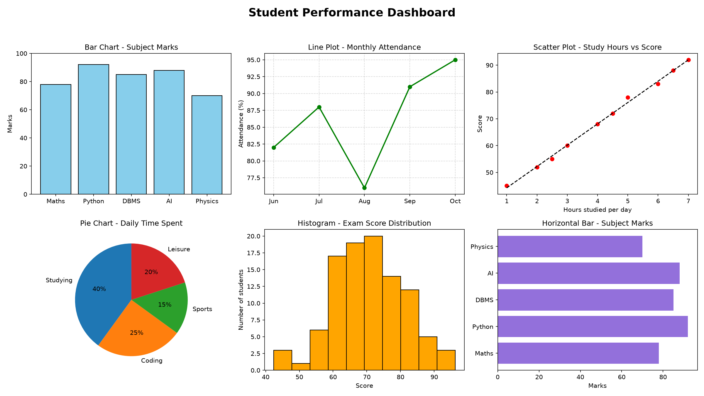

# Student Performance Dashboard

Mini project: plotting different types of graphs using the **Matplotlib** library (with **NumPy**), written in Python.

## Graphs included
- Bar chart: subject marks
- Line plot: monthly attendance
- Scatter plot with trend line: study hours vs score
- Pie chart: daily time spent
- Histogram: exam score distribution
- Horizontal bar chart: subject marks

## How to run
```
pip install -r requirements.txt
python student_performance_graphs.py
```

The program shows the dashboard window, saves it as `student_dashboard.png`, and prints the average, highest and lowest marks.


